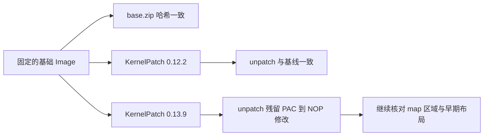

# KernelPatch 启动调查：基线与第一轮静态核对

2026-11-07，范围为当前仓库、用户现开 Codespace 和 ADB 已连接设备。
授权记录见 `work/kernelpatch-boot/scope.md`。这是启动故障调查，不涉及漏洞测试。

已固定可启动基线，完成构建检查修复，并发现 0.13.9 的 unpatch 不能逐字节还原原始内核。
后者已定位到工具对 PAC 指令的 NOP 替换，不足以认定启动失败的根因。
本轮没有刷机、重启设备、修改 KernelPatch 源码或重编译内核。

## 证据与结论

| 证据 | 已验证结果 | 结论与边界 |
| --- | --- | --- |
| E-01 `baseline-inventory.json` | base.zip 内 Image 与当前 Image 的 SHA256 相同 | 这两个文件可作为同一基线；能启动的结论来自交接中的刷机记录，本轮未重刷 |
| E-02 同上 | 通用名称 zip 内核 SHA256 不同 | 不应将旧通用 zip 当作此次对照组 |
| E-03 ADB 只读采集 | Recovery: `POCO F7 PRO`、`zorn`、`6.1.157-android14-11-g2de7246565ac-mi`，槽位 `_a` | 设备身份与交接一致；Recovery fingerprint 不能证明已安装系统的 ROM |
| E-04 ADB 只读采集 | `/sys/fs/pstore` 为空，`/proc/last_kmsg` 不存在 | 当前没有可用的这两类日志；不能据此定位失败阶段 |
| E-05 `kernelpatch-roundtrip.json` | 0.12.2 unpatch 后哈希与基线一致 | 支持这一包来自当前基线 |
| E-06 `kernelpatch-residuals.txt` | 0.13.9 unpatch 后同长度，40 字节差异分布在20条指令 | 不可用 unpatch 失败对等直接推断来源不同 |

基线 Image SHA256：
`e8485e67a83e63179a8d8a73464889334cbe2c7fbe4d464c1307560e20a63672`。

Codespace 已保存独立副本：
`.cache/baselines/<上述SHA256>/`，包括 `Image`、`config`、`kernel.release`、`base.zip`。
源码与 KernelPatch 的 commit、配置哈希及刷机包哈希详见 E-01。

## 0.13.9 的40字节差异

当前 KernelPatch checkout 为 `d4c88d6672687456b299e4b5153c24dc979d789b`。
`tools/patch.c:829` 起将 `kallsym_kimg` 的 map 区域复制回输出 Image。
`tools/patch.c:1039` 的 `unpatch_img()` 还原头部和原长度，没有恢复这一片代码。

与 `System.map` 对照后，差异范围为文件偏移 `0xe8fbf8..0xe90c14`，
涉及 `tcp_init_sock`、`tcp_poll` 等函数。共20个32位指令字：
原始 `0xd503233f` / `0xd50323bf`（PACIASP / AUTIASP）变为
`0xd503201f`（NOP），每条有2字节不同，合计40字节。
详见 E-06 的逐条位置和原始字节。

这解释了 unpatch 后残差，并非已验证的启动根因。需要进一步核对 map 选区、
运行时恢复及早期内存布局，不能直接生成“恢复这40字节就能启动”的刷机包。

另一个需要修正的解释：header `image_size` 是内存占用，并非文件长度。
0.12.2 的 payload 在启动时还会搬移，因此“文件长度小于 image_size”
也不能证明加载布局安全；只看头部是否增长不足以定位失败原因。



## 已落实的构建修复

- KPM 两入口默认输出目录统一为 `.cache/droidspaces/out`，支持显式 `OUT_DIR`。
- 配置片段明确保留 CFI/SCS，禁用实验性内置 KP。
- 共用配置检查在构建配置解析后、Codespace check、已有 Image 的 KP patch 前执行。
- 拒绝关闭 CFI/SCS、启用签名保护、启用 KP_LKM 或 KSU 的配置。
- 增加只读产物清单脚本，区分入口指令、文件长度和 header 内存大小。

远端原脚本备份在 `.cache/maintenance/20261107-134150/`。
所有改动保持未提交状态，未执行 push 或发布。

## 验证与复现

本地与 Codespace 的配置回归测试通过，覆盖已知失败配置；
Codespace 当前 `.config` 通过检查，修改的 Shell 脚本通过 `bash -n`，
`git diff --check` 通过。清单中四个 zip 均通过 CRC 检查。

```bash
python3 scripts/check-kernel-config.py .cache/droidspaces/out/.config
python3 scripts/test-kernel-config.py
python3 scripts/audit-artifacts.py "$PWD"
```

复现 unpatch 比较时，先将对应 zip 的 `Image.gz` 解压到临时目录，
使用同版本 `tools/kptools -u -i <patched> -o <restored>`，
再对 `<restored>` 与基线做 SHA256 和逐字节比较。不要打印 patch metadata，
其中可能包含 superkey。

## 后续验证顺序

1. 核对 0.13.9 map 选区、PAC/NOP 同步与运行时恢复范围，记录是否存在实际不一致。
2. 取得已安装系统 ROM 的身份信息；本轮可读路径未暴露系统 build.prop，未额外挂载分区。
3. 有明确可证伪假设后，基于固定 Image 准备单变量实验，并单独命名保存；
   管理器联调在 KPM 内核能启动之后进行。

启动根因、KPM 内核运行和管理器交互仍未验证。
