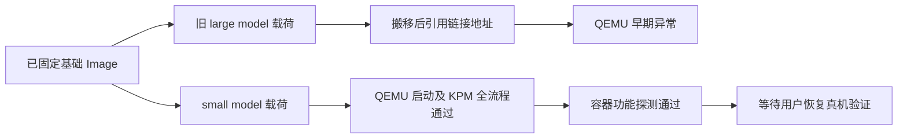

# 保留 KPM 的内核候选：编译错误定位与离线验证

后续更新：用户恢复授权后已完成实机开机、KPM 全流程与 namespace 验证，
详见 `device-verification.md`。以下保留离线阶段的证据与当时边界。

## 当前结论

已复现并修复旧 KP payload 在 QEMU 中的早期启动崩溃。
同一基础 Image、同一 KernelPatch 提交，仅将 large code model 改为 small，
即可进入用户态并完成真实 KPM 加载、控制和卸载。补回 Android 编译宏的最终候选也通过。
它还在 6GB RAM、EL1、开启 KASLR 的条件下通过容器功能探测。

**尚未完成真机 KPM 验证，不能声称已得到真机验证通过的 KPM 内核。**
用户确认不带 KP 的基础内核最终开机，手机启动较慢。
此前 KPM 试刷观察时间较短，停在 Logo 不足以判定失败。

用户当前要求只做离线分析，禁止继续实机验证；任何后续直接分区写入仅限 `boot_a`。
范围与约束见 `../work/kernelpatch-boot/scope.md`。

## E-01：旧版崩溃与编译错误

基础内核 SHA256：
`e8485e67a83e63179a8d8a73464889334cbe2c7fbe4d464c1307560e20a63672`。
KernelPatch commit：`d4c88d6672687456b299e4b5153c24dc979d789b`。

旧脚本强制使用 `-fno-pic -mcmodel=large`。
payload 会从链接地址搬移到内核分配的地址，但此组合产生了引用链接时地址的绝对寻址。
旧 payload 的 `start` 反汇编先将 `0x50000` 装入寄存器，再读取其 `+0x68` 偏移。
QEMU 的异常地址恰为 `0x50068`，属于不可访问的低地址。
0.12.2 旧产物也发生了同类早期地址错误。

这与之前“设备完全不兼容 KernelPatch”的结论不同：
至少存在一个可由构建参数解释、且已经在模拟环境验证修复的故障。
正式 0.13.9 发布提交 `b51197a...` 使用 large code model 重编译后也发生同类异常，
仅切换版本并不能修复这一编译错误。

证据：`qemu/original-0.13.9.Image-fad60b7a15eb.log`。
入口异常地址映射到 `start+0x34`；日志将载荷调用点显示为 `tcp_splice_read`，
那是 KP 临时占用的 map 区域，不能据此认定 TCP 栈是根因。

## E-02：对照验证

| 产物 / 条件 | 进入用户态 | KPM 加载 / 控制 / 卸载 | 容器运行时探测 |
| --- | --- | --- | --- |
| 基础 Image，1.5GB / EL2 / 关闭 KASLR | 是 | 未安装 KP，符合预期 | 当次未探测 |
| 旧 0.13.9，large model | 否，早期地址异常 | 未到达 | 未到达 |
| 同提交仅改 small model | 是 | 加载、计数、卸载成功 | 当次未探测 |
| small model + Android 宏 | 是 | 加载、控制回显、卸载成功 | 当次未探测 |
| 最终打包 Image，1.5GB / EL2 | 是 | 全部成功 | 当次未探测 |
| 最终打包 Image，6GB / EL1 / KASLR | 是 | 全部成功 | IPC/PID/UTS/MNT、cgroup2、devtmpfs 全部成功 |

最终测试返回：

```text
SMOKE_LOAD=0
SMOKE_NUMS=1
SMOKE_CONTROL=0
echo: smoke
SMOKE_UNLOAD=0
SMOKE_FINAL_NUMS=0
SMOKE_KPM_PASS
SMOKE_NAMESPACES=0
SMOKE_CGROUP2=0
SMOKE_DEVTMPFS=0
SMOKE_CONTAINER_PASS
```

实际创建/加载的是 `kpms/nbdemo`，不是模拟返回值。
guest init 直接发起 supercall 和 namespace/mount 系统调用；没有连接手机。
串口日志与测试 JSON 位于 `qemu/`。

## E-03：候选与回滚文件

| 文件 | SHA256 |
| --- | --- |
| `dist/Image.kpm-smallmodel` | `9fe4f75a96f0a17fde046ac1c45f3d718bcf4d24ba805c67a1760a90c16605ec` |
| `dist/AnyKernel3_zorn_droidspaces_kpm-smallmodel.zip` | `13444152dee432665a86325988924d7de4131db5ecaf6e51a43f19015f3e61b5` |
| `artifacts/device-backup/boot_a-kpm-smallmodel.img` | `98a3636a69015c688b74ddd92fe40d5fd0abeabdf2d69416f39525f71ef5736a` |
| 原始 `boot_a-before-kpm.img` | `1089ccf7b583c86c9ecc92746fc076da4d52cba57e564aa204060e7d16dd0ce1` |

最终 zip 内核逐字节等于已测试 Image。重打包 boot 镜像也经离线解包比对，
其内核哈希等于已测试 Image；用户原有 superkey 被保留，报告不包含 key。
手机 `boot_a` 实际大小为 96MB，备份完整保存本地。

最后实际写入的是不带 KP 的基础内核对照 boot 镜像，回读哈希：
`e3774043f0e8cb914653f44b05b63ca10acad6250eb668431aa5217657f1aec1`。
随后用户报告手机已开机。因后续要求禁止实机验证，未再读取设备确认内核或系统状态。
等待 Fastboot 的回滚监视已取消，不会自动继续刷机。

本轮直接分区写入仅发生在 `boot_a`。启动控制块的预读取因断连失败，
脚本在写入前退出，没有执行 misc 写入。后续明确禁止恢复此排查路径。

## 已落实的源码修复

- `kpm-patch-image.sh` 使用 `-mcmodel=small`，显式保留 `-DANDROID`。
- 不能只设置环境变量 `ANDROID=1`：命令行 CFLAGS 会覆盖 Makefile 的 `+=`，
  原先连 `-DANDROID` 也一起丢失。
- payload 缓存按提交、源码修改哈希、交叉编译器版本及完整参数检查，
  避免复用旧 large-model 载荷。需要重建时强制重新编译全部对象。
- 新 checkout 构建 host 工具前先生成匹配的 `preset.h`。
- integrated 入口复用同一个 payload 构建与校验流程。
- 修复 GNU readelf 的 ET_REL 类型文字误判，避免有效 KPM 被构建脚本拒绝。
- 保留 CFI、SCS、容器配置和 kABI 补丁，未重新编译或替换基础内核源码。

源码检查与配置回归测试通过。另以 GCC 13.3.0 实际运行了两次 payload 构建入口：
首次因签名变化完整重编译，第二次复用缓存，两个输出逐字节一致。
结果见 `payload-cache-validation.json`；这一缓存测试没有改写已打包并验证的候选文件。

## 离线复现

需要 Codespace 已有 qemu-system-aarch64、AArch64 GCC 和基础构建目录：

```bash
python3 scripts/qemu-kpm-smoke.py \
  --root "$PWD" --timeout 40 --memory 6144 --el1 --kaslr --require-kpm \
  dist/Image.kpm-smallmodel
python3 scripts/test-kernel-config.py
git diff --check
```

测试脚本只在 `.cache/qemu-kpm` 创建一次性 initramfs，启动 QEMU，
收集并脱敏串口日志；KPM 或容器探测不通过时返回失败。



## 后续边界

当前不做任何手机操作。恢复真机验证必须等用户明确解除限制，
先确认实际运行基线与系统启动完成状态，再准备足够长的观察窗口。
短暂未出现 ADB 或长时间 Logo 都不能单独判定失败。
只有真机完整开机并实测 KPM 加载/控制/卸载后，才能标为真机可用。
原始与压缩格式都已有本地 Image，压缩格式尚无独立失败证据，不应继续凭猜测切换格式试刷。

参考：[KernelPatch 源码](https://github.com/bmax121/KernelPatch)、
[0.13.9 发布记录](https://github.com/bmax121/KernelPatch/releases/tag/0.13.9)。
