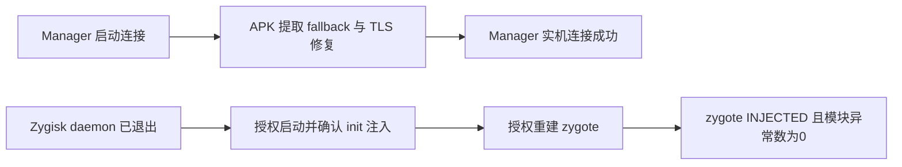

# Manager 闪退修复与 Zygisk Next 恢复验证

本轮未试刷内核，也未向任何分区进行原始写入。
覆盖更新了本项目的 Manager APK，保留原有数据；Zygisk Next 的服务启动与 zygote 重启均获用户明确授权。
没有卸载、禁用或更新用户的其他模块，没有改动 SELinux 策略。

## Manager：已修复并实机验证

报告的 `dropbox/data_app_crash@1794063929855.txt` 及后续两次崩溃均指向：

```text
java.lang.IllegalStateException: libkpctl.so missing from the APK; check abiFilters
  RootShell.ensureKpctl → RootShell.kpctl → KpmRepository.connect
```

APK 内实际上有 `lib/arm64-v8a/libkpctl.so`。旧逻辑只查 `nativeLibraryDir`，
没有处理现代 APK 不自动解压 native entry 的情况；异常又未转换为 UI 错误状态，
所以保存过密钥后启动自动连接会持续闪退。

修复版 **1.0.1 / versionCode 2**：

- 优先查 nativeLibraryDir，找不到时从已安装 base/split APK 中提取客户端。
- 以 SHA256 比较客户端内容，处理相同大小的升级；临时文件写完后替换，保留700权限。
- 提取或启动失败返回可显示错误，避免异常逃逸到主协程。
- ARM64 静态 Bionic 客户端的 TLS 段从8字节对齐改为64字节对齐；实际 ELF 已检查。
- 密钥改为 stdin 传递。旧命令中的临时环境赋值无法影响同一命令先行发生的变量展开；
  新逻辑也避免将密钥放进 su/kpctl 的命令行参数。
- 合并读取子进程输出，避免顺序读取 stdout/stderr 导致管道阻塞。

验证：Gradle assembleDebug 通过；同签名覆盖安装成功，数据保留；多次冷启动进程存活。
UI 实际显示 `KernelPatch connected · 0 module(s)`。
Zygisk 恢复注入后再次打开仍连接成功。证据为 `manager-verification.json` 和
`manager-zygisk-verification.json`。

交付 APK：`dist/KPM-Manager-1.0.1-debug.apk`。
SHA256：`d85465be54aa66f9e52278f1e86637bea422999b8571c0adb806fffcf39776a1`。

## Zygisk Next：当前运行与注入已恢复

用户提供的报告中，版本为 `1.5.2-864-a4a72ce-release`，当前状态是
`err: User requested to exit!`，守护进程已退出。
这条状态不能被直接解释为本次内核导致 native crash。
报告中命中注入模块的 tombstone_23 日期为2026-10-02，属于较早的第三方模块 JNI/文件加载异常，
不足以证明本次退出的原因。报告未记录此次退出的具体触发者。

获授权后启动 Zygisk Next 自身 daemon。日志显示：

```text
execve hook installed
wait4 hook installed
inject success!
daemon launched
```

daemon 识别 KernelSU、保留并加载原有3个64位和2个32位模块。
在已有系统中仅重开 daemon 时，`zygote_states` 仍为0，不能据此宣称应用注入完成。
用户进一步授权重启 Android zygote。新 zygote 与 system_server 建立后，最终状态为：

```text
zygote_states:1
zygote_state_0:1,0,31248,zygote,3,0
inject_state:1
root_status:KernelSU (32704)
root_impl:3
modules_with_issue:0
```

与该版本 WebUI 枚举核对，zygote state 1 为 INJECTED，inject_state 1 为 RUNNING。
因此当前不只是 daemon 存活，还已确认一个64位 zygote 注入成功。
内核 uptime 连续，从约1450秒增加到约1477秒，未重启内核。
未安装、禁用或删除其他模块；未做整机重启后的持久性验证。

原始 bugreport 和详细日志仅保存在 Git 忽略的 `artifacts/bugreports/`，未上传第三方。
最终摘要位于 `manager-zygisk-verification.json`。临时 UI/log 文件已从 `/dev` tmpfs 清理。


