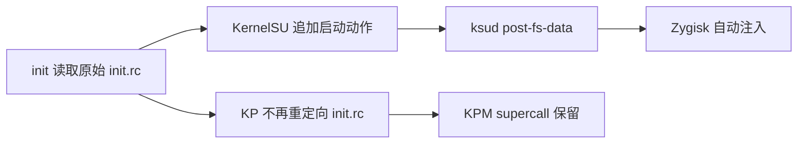

# KernelPatch 与 KernelSU 开机启动链冲突修复

修复版已完成正常重启验证：KernelSU 自行执行模块启动阶段，Zygisk Next 自动启动并注入；
KPM 全流程和 Manager 连接继续正常。该验证没有手动启动 Zygisk 或重启 zygote。
只写入 `boot_a`，没有手工修改其他分区。

## 根因与修复

KP 的 Android 用户态集成将 init 配置的 openat 路径从
`/system/etc/init/hw/init.rc` 改为 `/dev/user_init.rc`，附加 APatch daemon 启动动作。
KernelSU 的 read/fstat 注入严格识别原路径，因此这次重定向绕过了 KernelSU 的启动 RC 注入。
这与当前版本的 [KernelSU 源码](https://github.com/tiann/KernelSU/blob/528bafc5/kernel/runtime/ksud_integration.c) 相符。

故障启动日志只有 APatch `apd` 的启动失败，没有 ksud 启动阶段，也没有 Zygisk daemon 日志。
Zygisk 的状态文件仍保留上次手动恢复的时间，所以 `User requested to exit` 是旧状态，
不能被当作此次开机中新发生的崩溃栈。摘要见 `zygisk-reboot-evidence.txt`，认证字段已脱敏。

新增 `scripts/preserve-kp-init.py`，仅给 KP 的 init.rc openat hook 注册添加条件编译保护。
项目默认 `PRESERVE_ROOT_INIT=1`，保留 Android/KPM 能力，将模块启动交还已有的 KernelSU。
需要完整 APatch 用户态集成的独立环境可显式设为0；该模式不用于本设备的共存构建。
没有添加 service.d 延时脚本、修改 root 模块、关闭 SELinux 或绕过开机阶段补丁。

## 对照测试

QEMU 使用6GB、EL1、KASLR，initramfs 放置一个32字节的原始 init.rc 标记文件。
旧 payload 的读取内容被附加，`original_init_pass=false`；修复版读取内容逐字节保持原样。
两者的 KPM 与容器探测均通过，证明修复没有靠删除 KPM 能力换取兼容。

正常开机后的 dmesg 验证：

| 时间 | 结果 |
| --- | --- |
| 74.93秒 | init 执行 `ksud post-fs-data` |
| 75.26秒 | Zygisk daemon 自行启动 |
| 76.23秒 | ksud post-fs-data 返回0 |
| 77.02秒 | 新 zygote 注入成功 |
| 80.77秒 | ksud services 执行并返回0 |
| 97.41秒 | ksud boot-completed 执行并返回0 |

最终 `zygote_states:1`、zygote 状态 `INJECTED`、`modules_with_issue:0`，SELinux 仍 Enforcing。
KPM 0.13.9 的 hello/version/load/list/info/control/unload 均成功，计数0→1→0。
MNT/UTS/IPC/PID/NET unshare 探测通过；Manager 1.0.1 显示连接成功。

证据：`preserve-init-first-boot-status.txt`、`preserve-init-boot-events.txt`、
`preserve-init-device-verification.json`、`preserve-init-manager-verification.json`。

## 实机镜像与公开成品

实机 Image SHA256：`22ebf431b3786752327e7a09b0fe13a33ddc24efce8bda3082452a6f886030e0`。
实机 boot_a SHA256：`3f5bd956efea95d6af86875e4e1d212610aa051324785d03aed6cfb03fe30279`。
个人 boot 分区备份与原始手机日志不纳入 Git 或 Release。

按用户明确要求，公开成品保留原 superkey，不重设认证字段，因此与已验证的
Image/AnyKernel3 成品逐字节一致。不会另附明文密钥文件。
各成品的哈希以 Release 中的 SHA256SUMS 为准。

